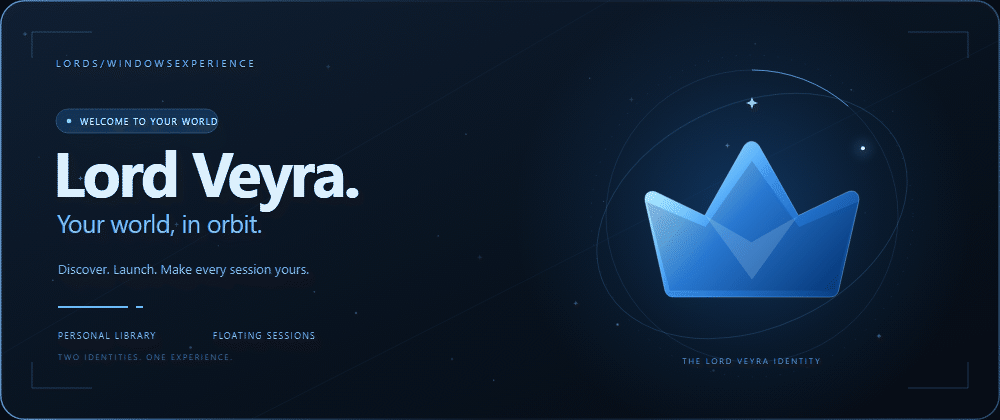
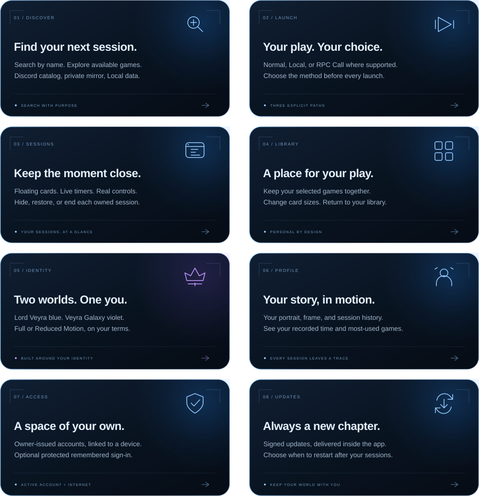
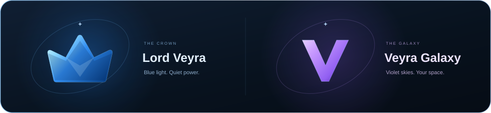
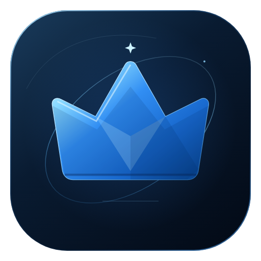

  <a href="https://github.com/LOoOrds/Lord-Veyra/releases/latest">
    <picture>
      <source media="(prefers-reduced-motion: reduce)" srcset="assets/hero.svg">
      
    </picture>
  </a>
    
  
  
  
    
  <strong>A personal Windows activity launcher, shaped around your sessions.</strong> 
  Maintained by Lords · Active account and internet required · Limited friend testing
    
  <a href="#the-experience">The experience</a> &nbsp; / &nbsp;
  <a href="#choose-your-path">Launch choices</a> &nbsp; / &nbsp;
  <a href="#step-inside">Get started</a> &nbsp; / &nbsp;
  <a href="#a-new-chapter-delivered">Updates</a> &nbsp; / &nbsp;
  <a href="README.ar.md">العربية</a>
    
  <a href="https://github.com/LOoOrds/Lord-Veyra/releases/latest"><picture><source media="(max-width: 680px)" srcset="assets/download-mobile.svg"></picture></a>
  Current release: <a href="https://github.com/LOoOrds/Lord-Veyra/releases/tag/v0.9.6">0.9.6</a> · Existing eligible installations can update inside the app.

 

## The experience

**From your first search to your last session.** A personal library, floating session cards, a profile that tells your story, and a visual identity that follows you through the experience.

<picture>
  <source media="(max-width: 680px)" srcset="assets/features-mobile.svg">
  
</picture>

<strong>Explore what is included</strong>

- **Discover:** search the game catalog, with Discord metadata, the private mirror, and validated Local profiles contributing the available choices.
- **Launch:** choose Normal, Local, or RPC Call explicitly where supported. Availability depends on the selected game and the method's requirements.
- **Sessions:** keep a floating card nearby, watch its timer, hide or restore it, and end the session directly.
- **Library:** save selected games between launches and choose the card size that fits your space.
- **Identity:** switch between Lord Veyra and Veyra Galaxy, with Full or Reduced Motion.
- **Profile:** choose your portrait, use a theme-aware frame, and review recorded activity and most-used games.
- **Access:** use an account issued by Lords, linked on its first eligible sign-in to its Windows device. Remembered sign-in is optional and protected locally by Windows.
- **Updates:** receive owner-signed updates inside the app, with verification, restart choices, and installation after active sessions finish.

 

## Two identities. One experience.

<picture><source media="(max-width: 680px)" srcset="assets/identities-mobile.svg"></picture>

The same library, account, and controls, expressed through two distinct themes. Your choice carries through the interface, profile frame, and session cards. Choose **Full Motion** for the complete presentation or **Reduced Motion** for a quieter experience.

 

## Choose your path

| Method | Your choice |
|:---|:---|
| **Normal** | The standard supported activity-launch route shown for the selected game. |
| **Local** | The available validated Local profile, with its required local prerequisites. |
| **RPC Call** | An explicit Rich Presence alternative, reached through **More Options** and its confirmation. |

Launch choices are separate. RPC is never selected silently. A session records activity in Lord Veyra; it does not guarantee actual in-game play or completion of an external quest.

 

## Step inside

**01 · Get your account** 
Obtain your username or email and password from Lords. Accounts are created by the owner; there is no public sign-up form.

**02 · Make it your space** 
[Download the latest Setup](https://github.com/LOoOrds/Lord-Veyra/releases/latest), choose the recommended location or an empty custom folder, and install. Setup can provision Microsoft WebView2 Runtime when it is missing.

**03 · Enter Veyra** 
Select **Launch Veyra**, sign in, and optionally enable **Remember me**. An active subscription and ongoing internet access are required.

**04 · Start your first session** 
Open **Add**, search for a supported game, add it to **Library**, then select **Play** and choose an available launch method.

You need no developer tools or separate application-data download for a normal installation.

 

## A new chapter, delivered

Updates belong inside the experience. Eligible installations check at authorized startup and through the existing account heartbeat, approximately every **five minutes**.

| When an update arrives | What you see |
|:---|:---|
| **As you open the app** | The branded download, verification, and installation flow. |
| **While you are inside** | A background download, followed by the update offer. Choose **Update now** or **Later**; the reminder remains accessible in the sidebar. |

Installation waits for active and pending sessions to finish. The genuine **0.9.5 to 0.9.6** upgrade passed local replacement/uninstall checks, and the owner confirmed a successful device update without losing settings. Remaining intermittent interface freezes are tracked separately.

Use the latest Setup for a **new installation**. Existing eligible users can follow the in-app update flow. [Read the current release notes](https://github.com/LOoOrds/Lord-Veyra/releases/tag/v0.9.6).

 

## The essentials

| Requirement | Details |
|:---|:---|
| **Windows** | Windows 10 or Windows 11, **64-bit**. |
| **Connection** | Working internet throughout authorized use. |
| **Account** | Credentials issued by Lords and an active subscription. |
| **WebView2** | Microsoft WebView2 Runtime; Setup provisions it when needed. |
| **Installation** | A writable directory. The recommended location is per Windows user; a custom directory must be empty. |

<strong>Accounts, devices, and session controls</strong>

The first eligible sign-in links an account to its Windows device. Logout or uninstall does not remove that server-side link; contact Lords if a reset is needed. Remembered access is still checked online.

The default simultaneous-session limit is **3**, adjustable from **1 to 10** in Settings. At most one RPC Call session can run at once. Lowering the limit preserves existing sessions and blocks new ones until capacity becomes available.

Closing the main window hides Lord Veyra to the tray. **End Session** stops the selected session. **Quit Veyra** stops the application's owned active sessions and exits. Reaching the end of a card's 15-minute timer does not automatically end its session.

<strong>Windows publisher notice</strong>

The current release uses a **self-signed development certificate**. It is not signed by a publicly trusted publisher, so Windows may display publisher or reputation warnings. The separate signed-update checks verify owner-issued update artifacts; they do not establish public Windows publisher trust.

<strong>Downloads and release statistics</strong>

The version badge follows the latest public GitHub release. The download badge shows cached GitHub release-asset downloads, including repeat downloads; it is not a count of users or installations. Downloads through the private in-app updater are separate.

 

## Keep shaping the experience

For account access, subscriptions, and device resets, contact Lords through your usual private support channel. For a reproducible application issue, [share feedback](https://github.com/LOoOrds/Lord-Veyra/issues) with the app version, Windows version, reproduction steps, and a screenshot when helpful. Remove account details; never post passwords, tokens, or administration keys.

This is the official public distribution and user-guide repository. Application source and private administration tools are maintained separately.

 

   
  <strong>L O R D &nbsp; V E Y R A</strong> 
  Your world, in orbit. &nbsp; Crafted by Lords.  
  <a href="https://github.com/LOoOrds/Lord-Veyra/releases/latest">Download</a> &nbsp; · &nbsp;
  <a href="https://github.com/LOoOrds/Lord-Veyra/releases">Release history</a> &nbsp; · &nbsp;
  <a href="https://github.com/LOoOrds/Lord-Veyra/issues">Feedback</a> &nbsp; · &nbsp;
  <a href="README.ar.md">العربية</a>  
  © 2026 Lords. Product identity and original presentation.

